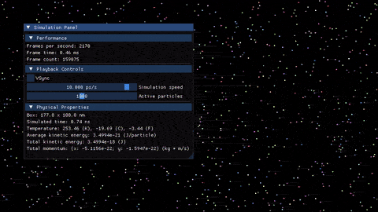

# temsi

[](https://en.wikipedia.org/wiki/C%2B%2B17)
[](https://www.khronos.org/opengl/)
[](https://cmake.org/)
[](LICENSE.txt)

Real-time 2D ideal gas simulation in C++17 and OpenGL 4.6: watch macroscopic temperature emerge directly from microscopic elastic particle motion.



<details>
<summary>Static Screenshot</summary>


</details>

---

## Features

- **Real-Time Statistical Mechanics:** Simulates up to 2,000 Argon-like particles undergoing elastic collisions and dynamically calculates macroscopic thermodynamic properties.
- **$O(N)$ Broad-Phase Collision Detection:** Uniform spatial grid implemented via linked-cell index lists (`head`/`next` chain) with half-shell neighbor sweeping, preventing all-pairs checks with zero per-frame dynamic heap allocations.
- **Order-Independent Collision Resolution:** Uses an impulse-based Jacobi-style solver that computes and accumulates simultaneous collision impulses before applying them, removing sequential resolution bias.
- **Instanced GPU Rendering:** Renders thousands of particles in a single OpenGL draw call (`glDrawElementsInstanced`), uploading only dynamic positions per frame while keeping static attributes in immutable VBOs. Antialiased circular particles are shaped smoothly in the fragment shader.
- **Letterboxed Aspect-Ratio Preservation:** Automatically letterboxes/pillarboxes the viewport to keep the fixed 16:9 physical box geometry undistorted regardless of window resizing or display aspect ratios.
- **Interactive UI & Metrics:** Integrated Dear ImGui control panel providing controls for simulation speed, active particle count, VSync, and live metrics for temperature ($K$, $^\circ C$, $^\circ F$), kinetic energy, and momentum.

---

## The Physics

### 1. Thermodynamic Model & Temperature
In a two-dimensional gas of hard disks, each particle possesses $2$ translational degrees of freedom ($x$ and $y$). By the equipartition theorem, each quadratic degree of freedom contributes $\frac{1}{2} k_B T$ to the average kinetic energy:

$$\langle E_k \rangle = 2 \times \left(\frac{1}{2} k_B T\right) = k_B T \implies T = \frac{\langle E_k \rangle}{k_B}$$

where:
- $\langle E_k \rangle = \frac{1}{N} \sum_{i=1}^N \frac{1}{2} m_i \lVert \mathbf{v}_i \rVert^2$ is the average kinetic energy per particle ($J$).
- $k_B \approx 1.380649 \times 10^{-23}\ \text{J/K}$ is the Boltzmann constant.
- With default Argon-like masses ($m \approx 6.6 \times 10^{-26}\ \text{kg}$) and initial speeds uniformly distributed in $[-400, 400]\ \text{m/s}$ along each axis, the expectation value $\langle v^2 \rangle = 2 \times \frac{400^2}{3} \approx 1.067 \times 10^5\ \text{m}^2/\text{s}^2$ yields an equilibrium temperature of approximately $250\text{--}260\ \text{K}$.

### 2. Elastic Collision Dynamics
When two disks $i$ and $j$ of masses $m_1, m_2$, radii $r_1, r_2$, positions $\mathbf{x}_1, \mathbf{x}_2$, and velocities $\mathbf{v}_1, \mathbf{v}_2$ collide ($\lVert \mathbf{x}_1 - \mathbf{x}_2 \rVert \le r_1 + r_2$ and $(\mathbf{v}_1 - \mathbf{v}_2) \cdot (\mathbf{x}_1 - \mathbf{x}_2) < 0$), the instantaneous momentum impulse along the collision normal is:

$$\mathbf{v}_1' = \mathbf{v}_1 - \frac{2 m_2}{m_1 + m_2} \frac{(\mathbf{v}_1 - \mathbf{v}_2) \cdot (\mathbf{x}_1 - \mathbf{x}_2)}{\lVert \mathbf{x}_1 - \mathbf{x}_2 \rVert^2} (\mathbf{x}_1 - \mathbf{x}_2)$$

$$\mathbf{v}_2' = \mathbf{v}_2 + \frac{2 m_1}{m_1 + m_2} \frac{(\mathbf{v}_1 - \mathbf{v}_2) \cdot (\mathbf{x}_1 - \mathbf{x}_2)}{\lVert \mathbf{x}_1 - \mathbf{x}_2 \rVert^2} (\mathbf{x}_1 - \mathbf{x}_2)$$

Wall boundaries are perfectly specular and elastic: when a particle hits a boundary at $\pm \text{half\_extent}$, its normal velocity component is reflected ($v_n \gets -v_n$) and position is clamped to prevent boundary penetration.

### 3. Physical Units & Scales

| Quantity | Simulation Unit | Real-World Analog |
|---|---|---|
| Box Dimensions | $177.8\ \text{nm} \times 100.0\ \text{nm}$ ($16:9$) | Microscopic nanoscale enclosure |
| Particle Mass ($m$) | $\approx 6.0\text{--}7.0 \times 10^{-26}\ \text{kg}$ | Argon atom ($^{40}\text{Ar} \approx 6.63 \times 10^{-26}\ \text{kg}$) |
| Particle Radius ($r$) | $0.4\ \text{nm}$ | Van der Waals radius enlarged $\sim 2\times$ for visibility |
| Initial Velocity ($\mathbf{v}$) | $\pm 400\ \text{m/s}$ | Thermal molecular speed at room temperature |
| Simulation Time Step | $10.0\ \text{ps / real second}$ (default) | $\Delta t_{\text{sim}} = \Delta t_{\text{real}} \times \text{speed} \times 10^{-12}\ \text{s}$ |

---

## Architecture Overview

```
temsi/
├── assets/
│   └── shaders/
│       ├── circle.vert        # Instanced vertex shader mapping SI metres to clip space
│       └── circle.frag        # Antialiased radial circle disc rendering
├── src/
│   ├── Application.cpp        # Application lifecycle, simulation loop, ImGui UI
│   ├── World.h                # Physical constants, dimensions, and simulation scale
│   ├── Paths.h                # Relocatable asset directory resolution
│   ├── Shader.h               # RAII OpenGL shader and program abstractions
│   ├── Buffers.h              # RAII OpenGL VAO, VBO, and EBO abstractions
│   ├── Timer.h                # Frame timing, deltaTime, and FPS metrics
│   └── Log.h                  # spdlog-backed multi-level logging utility
├── CMakeLists.txt             # FetchContent build setup and asset copy rules
└── CMakePresets.json          # Pre-configured build presets
```

### Key Implementation Details
- **Zero-Allocation Spatial Grid:** Spatial bins have cell dimension equal to particle diameter ($2r = 0.8\ \text{nm}$). A flat `cell_head` array stores the first particle index per cell, and `particle_next` acts as a linked list pointer per particle. Cells are checked against themselves and a 4-neighbor half-shell (Right, Bottom-Left, Bottom, Bottom-Right) to test all potential collision pairs exactly once.
- **Relocatable Binaries:** Assets are copied to `$<TARGET_FILE_DIR:temsi>/assets` at build time. `Paths::AssetsDir()` inspects `/proc/self/exe` on Linux or `GetModuleFileNameW` on Windows, eliminating hardcoded filesystem paths.

---

## Building and Running

### Prerequisites
- **CMake** $\ge 3.28$
- **C++17 Compliant Compiler** (GCC 9+, Clang 10+, or MSVC 2019+)
- **OpenGL 4.6** compatible GPU and drivers
- **Internet connection** for initial CMake configuration (fetches GLFW, GLAD, GLM, spdlog, and ImGui via `FetchContent`)

#### Linux Dependencies (Debian / Ubuntu)
```bash
sudo apt update
sudo apt install build-essential cmake ninja-build \
    libx11-dev libxrandr-dev libxinerama-dev libxcursor-dev libxi-dev \
    libgl1-mesa-dev libglu1-mesa-dev libwayland-dev libxkbcommon-dev
```

### Build Steps

#### Using CMake Presets (Linux Ninja Debug)
```bash
cmake --preset linux-debug
cmake --build out/build/linux-debug
./out/build/linux-debug/temsi
```

#### Generic Out-of-Source Build (Release)
```bash
cmake -B build -DCMAKE_BUILD_TYPE=Release
cmake --build build -j$(nproc)
./build/temsi
```

#### Windows (Visual Studio 2022)
Open the root directory in Visual Studio 2022 or use CMake Presets:
```cmd
cmake --preset x64-release
cmake --build out/build/x64-release
.\out\build\x64-release\temsi.exe
```

> [!NOTE]
> **Platform Support:** Linux and Windows are supported. macOS is **not supported** as Apple deprecated OpenGL and caps driver support at OpenGL 4.1 (OpenGL 4.6 Core Profile is required).

---

## Controls & Usage

- **Escape:** Exit the application.
- **Simulation Speed Slider:** Logarithmic speed adjustment in simulated picoseconds per real second ($0\text{--}20\ \text{ps/s}$). Set to $0$ to pause simulation.
- **Active Particles Slider:** Dynamically adjusts active particle count between $0$ and $2,000$.
- **VSync Checkbox:** Toggles monitor refresh synchronization (`glfwSwapInterval`).

---

## Known Limitations & Roadmap

- **Enlarged Particle Radii:** Particles are drawn with effective collision radius $r = 0.4\ \text{nm}$ (Argon van der Waals radius is $\approx 0.188\ \text{nm}$) to allow visual clarity in the UI viewport.
- **Hard-Sphere Potential:** Molecules behave as ideal hard elastic spheres without long-range Lennard-Jones potential forces (attractive dispersion or Pauli repulsion).
- **Tunneling at Extreme Speeds:** Highly accelerated particles under high time multipliers may travel more than one diameter per time step without continuous collision detection (CCD).
- **Roadmap:**
  - [ ] Real-time Maxwell–Boltzmann speed distribution histogram comparison.
  - [ ] Temperature control thermostats (Berendsen / Nosé–Hoover) and movable piston boundary for pressure experiments.
  - [ ] Automated continuous integration (CI) workflows for Linux and Windows builds.

---

## Third-Party Libraries

- [GLFW](https://www.glfw.org/) - Window creation and input handling
- [glad](https://github.com/Dav1dde/glad) - Multi-Language Vulkan/GL/GLES/EGL/GLX/WGL Loader-Generator
- [GLM](https://github.com/g-truc/glm) - OpenGL Mathematics
- [Dear ImGui](https://github.com/ocornut/imgui) - Bloat-free Immediate Mode Graphical User Interface
- [spdlog](https://github.com/gabime/spdlog) - Fast C++ logging library

---

## License

This project is licensed under the GNU General Public License v3.0 - see the [LICENSE.txt](LICENSE.txt) file for details.
